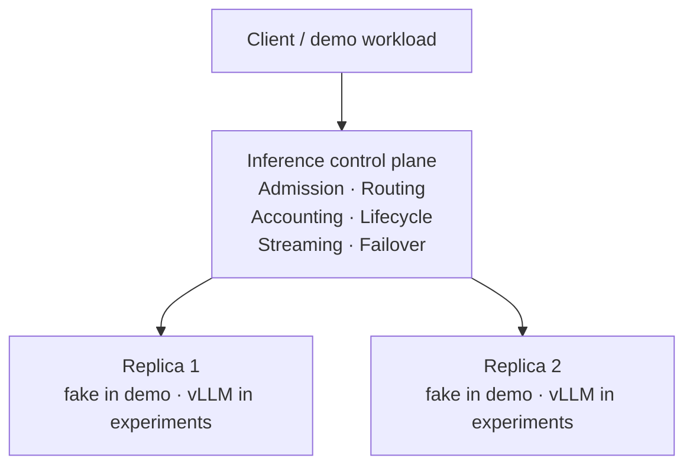

# vLLM inference control plane lab

[](https://github.com/mengyuan-ah/vllm-inference-control-plane/actions/workflows/ci.yml)

An experimental control plane and measurement suite for operating two vLLM replicas under
latency SLOs. The project combines an OpenAI-compatible streaming gateway with controlled GPU
experiments for routing, admission, overload, failover, and slow-replica recovery.

This is a bounded research project, not a production service. Its value is in the implementation,
measurement discipline, failure semantics, and evidence-backed conclusions.

## Try it in 60 seconds

No GPU, model weights, or vLLM installation required.

```bash
git clone https://github.com/mengyuan-ah/vllm-inference-control-plane.git
cd vllm-inference-control-plane
python3.12 -m venv .venv
.venv/bin/pip install -e '.[dev]'
make demo
```

The demo starts two deterministic OpenAI-compatible fake replicas and runs the canonical gateway
through routing, overload, and streaming-failover scenarios. It exercises the same gateway
implementation used by the GPU experiments; fake replicas are used only so the control-plane
behavior can be reproduced locally without GPUs. The demo illustrates mechanisms, while the
[measured results](docs/results.md) remain the source for GPU performance claims.

## System at a glance



The gateway preserves streamed Server-Sent Events and distinguishes failures before the first
content token from failures after content has reached the client. Experiments use fixed workloads,
open-loop arrival schedules, frozen protocols, and client-observed TTFT, TPOT, and end-to-end
latency.

## What is implemented

- OpenAI-compatible streaming proxy for `/v1/completions`
- Atomic replica selection and reservation accounting
- Count- and work-based headroom limits with bounded FIFO queueing
- Round-robin and outstanding-work-aware routing
- One alternate-replica retry before non-empty content; no unsafe replay after content
- Healthy, degraded, unhealthy, half-open, and recovering replica states
- Latency-based slow-replica detection and traffic reduction
- Deterministic fake backends and CPU-only integration tests
- Open-loop workload generation, experiment harnesses, analysis, and evidence audits

## Selected measured results

| Question | Controlled result | Interpretation |
| --- | --- | --- |
| Gateway overhead | Mean added TTFT `7.870 ms`; E2E `8.140 ms` at 1 request/s | Small measured low-load overhead on the tested path |
| Single-replica interactive capacity | `2.5 req/s` passed; `3.0 req/s` failed the fixed TPOT/E2E SLO | SLO capacity was far below peak closed-loop throughput |
| Overload admission | At 10 req/s, SLO successes improved from `63/768` to `624/768` | Admission protected useful completions under this overload |
| Bursty overload | Mean goodput gain `+1.25 req/s` (`+38.5%`) with a `43.75%` rejection trade-off | Benefit depended on the tested arrival pattern |
| Crash experiment | Control `540/540`; fault `534/540` SLO successes | Failure exclusion and survivor continuity worked; full recovery was censored |
| Slow replica | Pooled success improved `675/810` to `758/810`; all three recovery cycles completed | Reducing slow-path traffic improved SLO goodput without speeding delayed requests |

Every result is scoped to its recorded model, hardware, request shape, arrival pattern, and protocol.
See [results and limitations](docs/results.md) before reusing a number.

## Repository map

- [`src/gateway`](src/gateway) — canonical gateway implementation
- [`demo`](demo) — CPU-only runnable walkthrough using the canonical gateway
- [`tests`](tests) — CPU-only gateway unit and integration tests
- [`experiments/e5`](experiments/e5) through [`experiments/e11`](experiments/e11) — routing,
  admission, overload, failure, and slowdown experiments
- [`artifacts/summaries`](artifacts/summaries) — compact final reports, audits, and provenance
- [`artifacts/charts`](artifacts/charts) — selected presentation-quality performance figures
- [`docs/architecture.md`](docs/architecture.md) — design and request lifecycle
- [`docs/results.md`](docs/results.md) — portfolio-level result summary and claim boundaries

Full raw experiment preservation is maintained separately; this public repository retains the
canonical implementation, frozen protocols, compact evidence, and reviewed results needed to
understand the project.

## Local development

CPU-only tests use fake streaming backends; they do not require a GPU, vLLM, PyTorch, or model
weights.

```bash
python3.12 -m venv .venv
.venv/bin/pip install -e '.[dev]'
make check
```

The canonical test set covers the gateway and experiments E5-E11. GPU campaigns are intentionally
not part of CI.

## GPU reproduction boundary

The saved protocols record the exact model, vLLM build, request shape, seeds, server arguments, and
measurement definitions. Reproducing a GPU result still requires compatible hardware, local model
weights, and explicit review of the experiment's frozen protocol. Do not run all campaigns as one
automated suite.

## Honest limitations

- Results come from a controlled two-RTX-4090 lab, not production traffic.
- E3 did not establish a confirmed two-replica capacity boundary.
- E10 demonstrated exclusion and survivor continuity, but full gateway recovery was not observed
  within the 60-second window.
- E11 used a symmetric serving-path delay; it did not establish recovery from GPU-capacity loss.
- Three paired repetitions support descriptive conclusions, not broad statistical generalization.
- Sampled GPU and KV-cache extrema are not continuous maxima.

The detailed evidence ledger is in the
[Phase 2 final synthesis](artifacts/summaries/phase2-final-report.md). The single-replica foundation
is summarized in the
[Phase 1 final report](artifacts/summaries/phase1-final-report.md).
